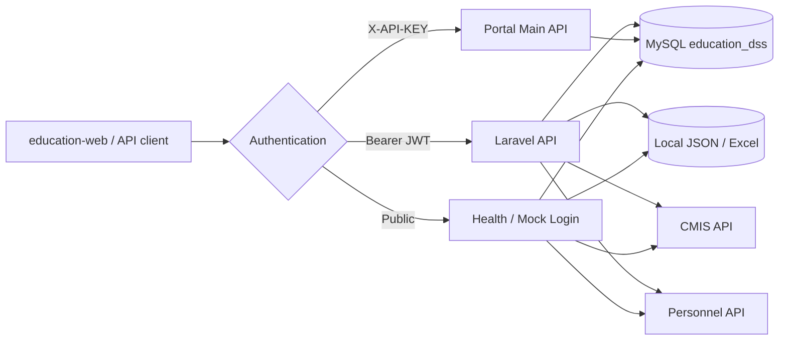
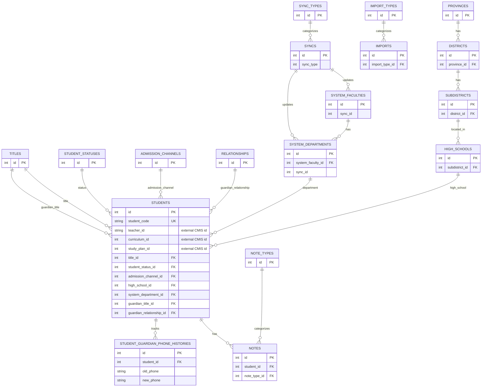

# Education API

REST API backend สำหรับระบบฐานข้อมูลนิสิต พัฒนาด้วย Laravel 12 และใช้งานคู่กับ frontend `education-web` ระบบดูแลข้อมูลนิสิต อาจารย์ที่ปรึกษา ข้อมูลอ้างอิง การนำเข้าไฟล์ Excel และข้อมูลผลการเรียน พร้อมเชื่อมต่อ CMIS และ Personnel API ของมหาวิทยาลัย

## ภาพรวมระบบ

ข้อมูลของระบบแบ่งเป็น 3 แหล่งหลัก:

| แหล่งข้อมูล | ข้อมูลที่รับผิดชอบ |
|---|---|
| MySQL (`education_dss`) | นิสิต อาจารย์ที่ปรึกษา ข้อมูลผู้ปกครอง master data ประวัตินำเข้า และประวัติ sync |
| Local storage (`storage/app/private`) | แผนการเรียน ผลการเรียน สรุปกราฟ ไฟล์นำเข้า และไฟล์ผลลัพธ์ |
| External APIs | หลักสูตร/แผนการเรียน/บุคลากรจาก CMIS และคณะ/ภาควิชาจาก Personnel API |



ประเด็นสำคัญของสถาปัตยกรรม:

- ตารางข้อมูลหลักไม่ได้ถูกสร้างครบจาก migration ใน repository นี้ แต่คาดว่าจะมาจาก SQL dump หรือฐานข้อมูลที่ทีมจัดเตรียม
- JWT ถูกออกโดยระบบภายนอก ส่วน API นี้ตรวจสอบลายเซ็นและเวลาใช้งานของ token ด้วย middleware ที่เขียนเอง
- ข้อมูลเกรดและแผนการเรียนถูกสร้างเป็น JSON แยกรายรหัสนิสิต ไม่ได้เก็บรายละเอียดรายวิชาทั้งหมดในฐานข้อมูล
- การสร้างหรือเปลี่ยนแผนการเรียนของนิสิตจะดึงข้อมูลจาก CMIS บันทึก snapshot และคำนวณไฟล์ผลการเรียนใหม่

## ความสามารถหลัก

### ข้อมูลนิสิต

- ค้นหาและกรองนิสิตตามอาจารย์ที่ปรึกษา ภาควิชา คณะ สถานะ ชื่อ และบันทึก
- เพิ่ม แก้ไข และ soft delete นิสิต พร้อมเก็บประวัติเมื่อเบอร์โทรผู้ปกครองเปลี่ยน
- มอบหมายหรือถอดอาจารย์ที่ปรึกษาหลายคนพร้อมกันแบบ transaction
- นำเข้านิสิตจาก Excel และดาวน์โหลดไฟล์ผลลัพธ์ของการนำเข้า
- จัดการบันทึกของนิสิตและประเภทบันทึก
- ดูภาพรวมผลการเรียนและรายวิชาที่ยังไม่เคยลงทะเบียน

### แผนการเรียนและผลการเรียน

- ดึงแผนการเรียนจาก CMIS และเก็บ snapshot ที่ `data/study_plan/{studentCode}.json`
- เมื่อสร้างนิสิต ระบบจะสร้าง `data/enrollments/{studentCode}.json` จากแผนการเรียนทันที แม้ยังไม่มีผลการเรียน
- นำเข้าเกรดจาก Excel ผ่าน queue และสร้างไฟล์ JSON สำหรับการลงทะเบียน วิชาที่ผ่าน/ไม่ผ่าน/เกินแผน และกราฟสรุป
- เก็บ `source_import_id` ระดับไฟล์ใน `data/grade_attempts/{studentCode}.json` เพื่ออ้างถึงงานนำเข้าล่าสุด
- รองรับการล้างผลการเรียนทั้งหมดหรือเฉพาะภาคการศึกษาก่อนหน้าผ่าน `DELETE /api/students/{studentCode}/grades`

### Master data และระบบภายนอก

- CRUD ข้อมูลคำนำหน้าชื่อ ช่องทางรับเข้า โรงเรียนเดิม ความสัมพันธ์ผู้ปกครอง สถานะนิสิต ประเภทบันทึก และประเภทนำเข้า
- ให้บริการ list-of-values สำหรับฟอร์ม รวมถึงหลักสูตร แผนการเรียน บุคลากรหลักสูตร และนิสิตที่กำลังศึกษา
- Sync คณะและภาควิชาจาก Personnel API พร้อมบันทึกจำนวนรายการที่เพิ่ม แก้ไข ปิดใช้งาน และข้าม
- ให้บริการ Portal Main แบบ server-to-server ด้วย API key แยกจาก JWT

## เทคโนโลยี

| ส่วน | เทคโนโลยี |
|---|---|
| Backend | PHP ^8.2, Laravel 12 |
| Database / ORM | MySQL 8 หรือ MariaDB, Eloquent |
| Authentication | HMAC JWT: HS256, HS384 หรือ HS512 |
| Excel | SimpleXLSX, SimpleXLSXGen |
| Queue | Laravel Queue (`sync` หรือ `database`) |
| Asset build | Vite 7, Tailwind CSS 4 |
| Testing / style | PHPUnit 11, Laravel Pint |
| External services | CMIS API, Personnel API |

`laravel/sanctum` ยังอยู่ใน dependencies จาก Laravel skeleton แต่ endpoint ปัจจุบันใช้ `AuthenticateJwt` ไม่ได้ใช้ Sanctum ในการยืนยันตัวตน

## Requirements

- PHP >= 8.2 พร้อม extensions ที่ Laravel และ MySQL ต้องใช้ เช่น `pdo_mysql`, `mbstring`, `openssl`, `xml`, `ctype`, `json` และ `bcmath`
- Composer 2.x
- Node.js และ npm เมื่อต้องใช้ Vite หรือแก้ asset ของ Laravel
- MySQL 8.x หรือ MariaDB พร้อม schema `education_dss`
- URL/credential สำหรับ CMIS, Personnel API และ JWT secret จากทีมที่ดูแลระบบ

## การติดตั้งแบบ local

> `.env.example` ยังใช้ค่าเริ่มต้นแบบ Laravel skeleton (`sqlite`, database session/cache/queue) จึงต้องแก้ค่าให้ตรงกับ environment ก่อนเปิดระบบ

```bash
git clone <repo-url> education-api
cd education-api
composer install
cp .env.example .env
php artisan key:generate
npm install
```

บน PowerShell ใช้ `Copy-Item .env.example .env` แทนคำสั่ง `cp`

ค่าขั้นต่ำที่ควรตรวจใน `.env`:

```env
APP_NAME="Education API"
APP_ENV=local
APP_DEBUG=true
APP_URL=http://localhost:8000

DB_CONNECTION=mysql
DB_HOST=127.0.0.1
DB_PORT=3306
DB_DATABASE=education_dss
DB_USERNAME=root
DB_PASSWORD=

# ใช้ file/sync ได้โดยไม่ต้องพึ่งตารางระบบของ Laravel
SESSION_DRIVER=file
CACHE_STORE=file
QUEUE_CONNECTION=sync

JWT_SECRET=<shared-secret>
JWT_ALGORITHM=HS256
JWT_REQUIRE_EXPIRATION=false

CMIS_URL=http://localhost:8001
CMIS_SERVICE_BASE_PATH=/api
PERSONNEL_API_URL=https://office.eng.kps.ku.ac.th

FRONTEND_URL=http://localhost:3001,http://localhost:3002
```

จากนั้นเริ่ม API:

```bash
php artisan serve
```

API จะอยู่ที่ `http://localhost:8000/api` และ health check พื้นฐานอยู่ที่ `http://localhost:8000/up`

หากต้องการรัน server, queue listener, log viewer และ Vite พร้อมกัน ใช้:

```bash
composer run dev
```

เมื่อใช้ `QUEUE_CONNECTION=database` ต้องมีตาราง `jobs`/`failed_jobs` และเปิด queue worker ไว้ตลอดเวลา หากเลือก database driver ให้ session หรือ cache ด้วย ต้องมีตารางของส่วนนั้นเช่นกัน ส่วน `QUEUE_CONNECTION=sync` จะประมวลผลงานนำเข้าเกรดภายใน request โดยไม่ต้องมี worker

## Database setup

โฟลเดอร์ `database/migrations` มีเฉพาะตารางพื้นฐานจาก Laravel เช่น `users`, `cache`, `jobs` และ `personal_access_tokens` แต่ไม่มี migration สำหรับตารางโดเมนหลัก ดังนั้น:

1. ขอ SQL dump ของ `education_dss` หรือสิทธิ์เข้าถึงฐานข้อมูลจากทีม
2. Import schema/data แล้วตั้งค่า `DB_*` ใน `.env`
3. อย่ารัน `php artisan migrate` กับฐานข้อมูลที่ใช้งานร่วมกันโดยไม่ตรวจ migration และยืนยันกับผู้ดูแลฐานข้อมูลก่อน

ตารางที่ model ปัจจุบันใช้งาน ได้แก่:

```text
students, student_guardian_phone_histories, titles, student_statuses,
admission_channels, high_schools, relationships, notes, note_types,
imports, import_types, system_faculties, system_departments, sync_types,
syncs, provinces, districts, subdistricts
```

การเพิ่มนิสิตต้องส่ง `system_department_id` ที่เปิดใช้งาน รวมทั้ง `curriculum_id` และ `study_plan_id` จาก CMIS ระบบไม่ได้อนุมานภาควิชาจากแผนการเรียน

## Docker Compose

Compose stack ประกอบด้วย MySQL, phpMyAdmin, backend และ frontend โดยคาดว่า repository `education-web` อยู่ข้างกัน:

```text
parent-directory/
├── education-api/
└── education-web/
```

ก่อนรันครั้งแรก:

1. วาง SQL dump ไว้ที่ `docker/db/*.sql` ไฟล์นี้ถูก `.gitignore` เพราะอาจมีข้อมูลนิสิตจริง
2. เตรียม `.env` หรือ `.env.production` โดยอย่างน้อยต้องมี `APP_KEY`, `DB_PASSWORD`, `JWT_SECRET`, `CMIS_URL`, `PERSONNEL_API_URL` และ `PORTAL_MAIN_API_KEY`
3. ถ้า volume `dbdata` ถูกสร้างไปแล้ว การเพิ่ม dump ภายหลังจะไม่ทำให้ MySQL import ซ้ำโดยอัตโนมัติ

```bash
docker compose up -d --build
```

| Service | URL / port |
|---|---|
| Backend | `http://localhost:3009` |
| Frontend | `http://localhost:3008` |
| phpMyAdmin | `http://localhost:8080` |
| MySQL | ใช้งานภายใน Compose network ที่ `mysql:3306` |

backend container กำหนด `SESSION_DRIVER=file`, `CACHE_STORE=file` และ `QUEUE_CONNECTION=sync` ไว้โดยตั้งใจ จึงไม่ต้องมี queue worker แยกใน Compose

ตัวอย่าง production/staging:

```bash
cp .env.production.example .env.production
docker compose --env-file .env.production up -d --build
```

`FRONTEND_URL` รองรับหลาย origin คั่นด้วย comma และใช้กำหนด CORS ส่วน `MOCK_LOGIN_FRONTEND_URL`/`MOCK_LOGIN_STUDENT_FRONTEND_URL` เป็นปลายทาง redirect หลัง mock login ค่า `VITE_API_URL` จะถูกฝังตอน build frontend จึงต้อง rebuild เมื่อ URL เปลี่ยน

## Authentication

| Route | การยืนยันตัวตน |
|---|---|
| `/up` | ไม่ใช้ JWT; Laravel built-in health route |
| `GET /api/health` | ไม่ใช้ JWT; ส่ง health token เมื่อต้องการรายละเอียด |
| `/api/mock-login/*` | ไม่ใช้ JWT แต่เปิดได้เฉพาะเมื่อ `MOCK_LOGIN_ENABLED=true` และ `APP_ENV` ไม่ใช่ `production` |
| `/api/portal-main-student/*` | Header `X-API-KEY: <PORTAL_MAIN_API_KEY>` |
| `/api/*` อื่นทั้งหมด | Header `Authorization: Bearer <jwt-token>` |

JWT config อยู่ใน `config/jwt.php` รองรับ `JWT_SECRET`, `JWT_ALGORITHM`, `JWT_REQUIRE_EXPIRATION` และค่าเสริม `JWT_ISSUER`, `JWT_AUDIENCE`, `JWT_LEEWAY`

Claims ที่ระบบอ่าน ได้แก่ `nontri_id`, `name`, `role`, `current_role`, `department_id`, `faculty_id`, `study_plan_id`, `iat` และ `exp` ทั้งนี้ middleware ปัจจุบันตรวจสอบความถูกต้องของ token แต่ยังไม่มี middleware แยกสิทธิ์ราย role ที่ระดับ route

```bash
curl http://localhost:8000/api/me \
  -H "Authorization: Bearer <jwt-token>"
```

รูปแบบ response มาตรฐาน:

```json
{
  "success": true,
  "message": "OK",
  "data": {}
}
```

```json
{
  "success": false,
  "message": "Error message",
  "errors": null
}
```

## กลุ่ม API

ดู route และ HTTP method ล่าสุดจาก source ได้ด้วย:

```bash
php artisan route:list --path=api --except-vendor
```

| กลุ่ม | Endpoint สำคัญ | หน้าที่ |
|---|---|---|
| Current user | `GET /api/me` | อ่านข้อมูลผู้ใช้จาก JWT claims |
| Students | `/api/students` | ค้นหา ดู เพิ่ม แก้ไข และ soft delete นิสิต |
| Student advisor | `GET /api/students/studying`, `GET /api/students/studying/without-advisor`, `PATCH /api/students/advisor` | รายชื่อนิสิตและการมอบหมายอาจารย์ |
| Academic data | `GET /api/students/{id}/academic-overview`, `GET /api/students/{id}/unattempted-courses` | รวมข้อมูลเกรด แผน และรายวิชาที่ยังไม่เคยลง |
| JSON data | `GET /api/students/{studentCode}/enrollments`, `/enrollment-statuses`, `/performance-summary` | อ่านผลลัพธ์ JSON รายคน |
| Grade reset | `DELETE /api/students/{studentCode}/grades` | ล้างเกรดทั้งหมดหรือภาคก่อนหน้า |
| Student import | `GET /api/students/import/template`, `POST /api/students/import` | ดาวน์โหลด template และ import นิสิตแบบ synchronous |
| Grade import | `GET /api/grades/import/template`, `POST /api/grades/import` | ดาวน์โหลด template และส่งงาน import เกรดเข้า queue |
| Import history | `GET /api/imports`, `GET /api/imports/{id}/result` | ติดตามและดาวน์โหลดผลการนำเข้า |
| Notes | `GET/POST /api/notes`, `DELETE /api/notes/{id}` | บันทึกช่วยจำของนิสิต |
| List of values | `GET /api/list-of-values/{type}` | ตัวเลือกสำหรับฟอร์มจาก DB หรือ CMIS |
| Curriculum | `GET /api/curriculum-categories`, `GET /api/curriculum-plan-courses` | ส่งต่อข้อมูลแผนการเรียนจาก CMIS |
| Master data | `/api/titles`, `/api/admission-channels`, `/api/high-schools`, `/api/relationships`, `/api/student-statuses`, `/api/note-types`, `/api/import-types` | CRUD และเปลี่ยนสถานะข้อมูลอ้างอิง |
| Organization | `/api/system-faculties`, `/api/system-departments`, `POST .../sync`, `GET /api/syncs` | ข้อมูลคณะ/ภาควิชาและประวัติ sync |
| Portal Main | `/api/portal-main-student/*` | ตรวจสอบ ดึง และค้นหาผู้ใช้สำหรับระบบอื่น |
| Health | `GET /api/health` | ตรวจ DB, migration, queue, storage, frontend และ external APIs |

ค่า `{type}` ของ list-of-values ที่รองรับ:

```text
titles, admission-channels, relationships, student-statuses,
study-semesters, note-types, import-types, high-schools, provinces,
districts, subdistricts, system-departments, system-faculties,
curriculums, study-plans, curriculum-personnel, students
```

รายละเอียด Portal Main API อยู่ที่ [`docs/portal-main-student-api.md`](docs/portal-main-student-api.md)

## การนำเข้า Excel

### นิสิต

`POST /api/students/import` ทำงานใน request เดียวและตอบกลับเป็นไฟล์ Excel สรุปผล พร้อม headers `X-Import-Id`, `X-Import-Total`, `X-Import-Success` และ `X-Import-Failed` ต้องส่ง `file`, `system_department_id`, `curriculum_id`, `curriculum_code`, `study_plan_id` และ `study_plan_name_th`

### เกรด

`POST /api/grades/import` สร้างรายการในตาราง `imports`, เก็บ source ที่ `imports/grades/{importId}/source.xlsx` แล้ว dispatch `ProcessGradeImport` จากนั้นผลลัพธ์จะอยู่ที่ `imports/grades/{importId}/result.xlsx` และดาวน์โหลดผ่าน `GET /api/imports/{id}/result`

ไฟล์ทั้งสองประเภทต้องเป็น `.xlsx` และมีขนาดไม่เกิน 20 MB

## Runtime files

ทุก path ด้านล่างอยู่ภายใต้ `storage/app/private/`:

```text
data/
├── study_plan/{studentCode}.json
├── grade_attempts/{studentCode}.json
├── enrollments/{studentCode}.json
├── enrollments_pass/{studentCode}.json
├── enrollments_not_pass/{studentCode}.json
├── enrollments_over/{studentCode}.json
└── graph/
    ├── by_credit/{studentCode}.json
    ├── by_semester/{studentCode}.json
    └── by_group/{studentCode}_{index}.json

imports/
├── students/{importId}/result.xlsx
└── grades/{importId}/
    ├── source.xlsx
    └── result.xlsx
```

ไฟล์เหล่านี้เป็น runtime data และอาจมีข้อมูลส่วนบุคคล ห้าม commit ลง Git และควรสำรอง/เคลื่อนย้ายผ่านช่องทางที่ทีมอนุมัติเท่านั้น Endpoint แบบ bundle จะคืน 404 เมื่อไม่พบทุก section หรือคืน `missing_sections` เมื่อพบข้อมูลเพียงบางส่วน

## Health check

`GET /api/health` ตรวจ `database`, `migrations`, `queue`, `storage`, `frontend`, `cmis` และ `personnel_api`

- critical check ล้มเหลว: status `down`, HTTP 503
- external service ล้มเหลว: status `degraded`, HTTP 200
- ไม่มี health token: แสดงเฉพาะ `ok`, `skipped` และ `critical`
- ส่ง `?token=<HEALTH_TOKEN>` หรือ header `X-Health-Token`: แสดงรายละเอียด เวลา และ error เพิ่มเติม

ค่าที่เกี่ยวข้องคือ `HEALTH_TOKEN`, `HEALTH_FRONTEND_URL`, `HEALTH_QUEUE_WORKER_MAX_SILENCE`, `HEALTH_EXTERNAL_CACHE_SECONDS` และ `HEALTH_EXTERNAL_TIMEOUT`

## Project structure

```text
app/
├── Actions/Students/        # use case การบันทึกนิสิตและมอบหมายอาจารย์
├── Contracts/               # interface สำหรับ CMIS/Teacher API
├── Enums/                   # ประเภท list-of-values
├── Http/
│   ├── Controllers/Api/     # HTTP endpoints
│   ├── Middleware/          # JWT และ Portal Main API key
│   ├── Requests/            # validation ของ request
│   └── Responses/           # ตัวแปลง response ของ resource
├── Jobs/                    # งาน queue สำหรับ import เกรด
├── Models/                  # Eloquent models ของ education_dss
└── Services/
    ├── Grades/              # อ่าน import, คำนวณเกรด และสร้าง JSON
    ├── PortalMain/          # query สำหรับ Portal Main
    ├── Storage/             # อ่าน/เขียน JSON แบบ local
    ├── Students/            # query, import และ academic overview
    └── StudyPlans/          # ดึง/เก็บ snapshot แผนการเรียน

config/                      # JWT, CMIS, CORS, health, mock login ฯลฯ
database/migrations/         # migration พื้นฐานของ Laravel เท่านั้น
docs/                        # เอกสาร integration เพิ่มเติม
resources/templates/         # Excel templates
resources/mocks/             # mock users สำหรับ development
routes/api.php               # API routes
storage/app/private/         # JSON และไฟล์ import ที่สร้างขณะทำงาน
```

## Testing และ code style

```bash
composer test
# หรือ
php artisan test

./vendor/bin/pint --test
```

`phpunit.xml` เตรียม test environment ด้วย SQLite in-memory, array cache/session และ sync queue ไว้แล้ว แต่ ณ โครงสร้างปัจจุบันยังไม่มี test case ที่ถูก track ใน `tests/` การเปลี่ยน business logic สำคัญควรเพิ่ม Feature/Unit tests ก่อนนำขึ้นใช้งานจริง

## ER diagram

แผนภาพนี้อ้างอิงความสัมพันธ์ที่ model ใช้งาน ความเป็น foreign key จริงอาจต่างกันตาม SQL dump ของแต่ละ environment



`curriculum_id`, `study_plan_id` และ `teacher_id` ใน `students` เป็นรหัสจากระบบภายนอก จึงไม่มี model ปลายทางภายในโปรเจกต์นี้
