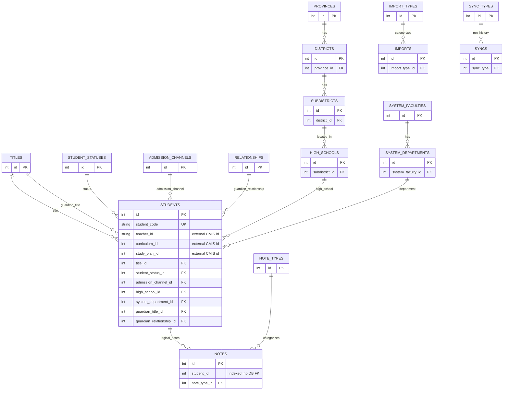

# Education API

REST API backend (Laravel 12) สำหรับ **ระบบฐานข้อมูลนิสิต** ใช้คู่กับ Frontend `education-web` (React) โปรเจกต์นี้ทำหน้าที่เป็นศูนย์กลางข้อมูลนิสิต หลักสูตร อาจารย์ที่ปรึกษา และเชื่อมต่อ/ประสานข้อมูลกับระบบภายนอกของมหาวิทยาลัย (ระบบบุคลากร, ระบบทะเบียน)

## Project Description

ระบบนี้เก็บและให้บริการข้อมูลของนิสิต (ประวัติ, สถานะการศึกษา, อาจารย์ที่ปรึกษา, แผนการเรียน/หลักสูตร) โดยมีจุดสำคัญคือ

- **ไม่ได้เป็นเจ้าของฐานข้อมูลหลักเพียงผู้เดียว** — ตาราง Eloquent เช่น `students`, `system_departments` และ master data ชี้ไปยังฐานข้อมูล MySQL ที่มีอยู่แล้ว (`education_dss`) ซึ่งถูกสร้าง/ดูแลจากภายนอกโปรเจกต์ Laravel นี้ (ดูหัวข้อ [Database Setup](#database-setup))
- **Authentication เป็นแบบ JWT ที่ออกโดยระบบอื่น** (SSO/ระบบบุคลากรมหาวิทยาลัย) — API นี้แค่ตรวจสอบลายเซ็นของ token ที่ส่งเข้ามา ไม่มีหน้า login เป็นของตัวเอง
- **Sync ข้อมูลจากระบบภายนอก** — คณะ/ภาควิชา (System Faculty/Department) ถูกดึงจาก Personnel API ผ่าน endpoint `*/sync` ส่วนรายชื่ออาจารย์อ่านจาก CMIS API โดยไม่เก็บตารางหรือประวัติ sync ในฐานข้อมูลนี้
- **ข้อมูลผลการเรียน/การลงทะเบียน** (enrollments, เกรด, กราฟสรุปผล) ไม่ได้เก็บใน DB แต่อ่านจากไฟล์ JSON ที่วางไว้ใน storage ของแอป (ดูหัวข้อ [Usage](#usage))

## Features

### จัดการข้อมูลนิสิต (Students)
- ค้นหา/กรองรายชื่อนิสิตตามอาจารย์ที่ปรึกษา, ภาควิชา, คณะ, สถานะการศึกษา, ชื่อ, หรือข้อความในบันทึก (`GET /api/students`)
- ดูรายชื่อ "นิสิตที่กำลังศึกษาอยู่" ของอาจารย์คนหนึ่ง (`GET /api/students/studying`)
- ดูรายชื่อ "นิสิตที่ยังไม่มีอาจารย์ที่ปรึกษา" แยกตามภาควิชา (`GET /api/students/studying/without-advisor`)
- มอบหมาย/ถอดอาจารย์ที่ปรึกษาให้นิสิตหลายคนพร้อมกันแบบ transaction ป้องกันการชนกันของอาจารย์ (`PATCH /api/students/advisor`)
- เพิ่ม/แก้ไข/ลบ (soft delete) ข้อมูลนิสิตรายคน พร้อมคำนวณชั้นปี/ภาคการศึกษาปัจจุบัน โดยระบุภาควิชาผ่าน `system_department_id` (`App\Actions\Students\SaveStudent`, `AcademicStandingCalculator`)
- บันทึกช่วยจำ (Notes) แนบกับนิสิตแต่ละคน พร้อมประเภทบันทึก (`/api/notes`)

### ข้อมูลผลการเรียน/การลงทะเบียน (จากไฟล์ JSON)
- ดึงข้อมูลการลงทะเบียนเรียนของนิสิตรายคน (`/api/students/{studentCode}/enrollments`)
- ดึงสถานะรายวิชา: ผ่าน/ไม่ผ่าน/เกินแผน (`/api/students/{studentCode}/enrollment-statuses`)
- ดึงข้อมูลสรุปผลการเรียนสำหรับทำกราฟ/แดชบอร์ด แยกตามหน่วยกิต, กลุ่มวิชา, ภาคการศึกษา (`/api/students/{studentCode}/performance-summary`)

### อาจารย์ / โครงสร้างองค์กร
- รายชื่ออาจารย์ที่ปรึกษาอ่านจาก CMIS API ผ่าน `GET /api/list-of-values/curriculum-personnel`
- คณะ/ภาควิชา (ระบบ) พร้อม sync จาก Personnel API (`/api/system-faculties`, `/api/system-departments` และ `*/sync`)

### ข้อมูลอ้างอิง (Master/Reference data)
คำนำหน้าชื่อ, ช่องทางการรับเข้า, โรงเรียนเดิม, ความสัมพันธ์ผู้ปกครอง, สถานะการศึกษา และประเภทบันทึกมี endpoint ของระบบ ส่วนหลักสูตร แผนการเรียน และบุคลากรหลักสูตรอ่านจาก CMIS API ผ่าน `GET /api/list-of-values/{type}`

### Sync log
- ดูประวัติ/สถานะการ sync ล่าสุดของแต่ละประเภท (`GET /api/syncs`)

### ข้อมูลหลักสูตรจากระบบภายนอก
ข้อมูลหลักสูตร รายวิชา และวิทยาเขตถูกอ่านจาก CMIS API ภายนอก ส่วน `Province`, `District` และ `Subdistrict` ใช้เป็นข้อมูลที่อยู่ของโรงเรียนในฐานข้อมูลนี้

## Technologies

| ประเภท | เทคโนโลยี |
|---|---|
| Backend Framework | Laravel 12 (PHP ^8.2) |
| Database | MySQL (เชื่อมต่อฐานข้อมูล `education_dss` ที่มีอยู่แล้ว) |
| Authentication | Custom JWT middleware (`App\Http\Middleware\AuthenticateJwt` + `App\Services\JwtVerifier`, รองรับ HS256/384/512) — token ออกโดยระบบภายนอก |
| ORM | Eloquent |
| Frontend build (asset ของ Laravel เอง) | Vite 7, TailwindCSS 4 |
| Testing | PHPUnit 11 |
| Code style | Laravel Pint |
| External integration | CMIS API และ Personnel API ของมหาวิทยาลัย |

> หมายเหตุ: โปรเจกต์ยังมี `laravel/sanctum` ติดตั้งอยู่ (มาจาก Laravel skeleton เริ่มต้น) แต่ API ปัจจุบัน**ไม่ได้ใช้ Sanctum ในการยืนยันตัวตน** — ใช้ JWT middleware ที่เขียนเองแทนทั้งหมด

## Requirements

- PHP >= 8.2 พร้อม extension ที่ Laravel 12 ต้องการ (pdo_mysql, mbstring, openssl, tokenizer, xml, ctype, json, bcmath)
- Composer 2.x
- Node.js + npm (สำหรับ build asset ของ Laravel เอง เช่นหน้า welcome/Vite)
- MySQL 8.x / MariaDB ที่เข้าถึงฐานข้อมูล `education_dss` ได้ (ต้องขอไฟล์ dump หรือสิทธิ์เข้าถึงจากทีม)
- ไฟล์ `.env` ที่มีค่าเชื่อมต่อจริง (ฐานข้อมูล, `JWT_SECRET`, `PERSONNEL_API_URL`) — ขอจากทีม/หัวหน้างาน

## Installation

เปิด MySQL/MariaDB ในเครื่องก่อนเริ่ม API (เช่นผ่าน XAMPP บน Windows หรือ
`brew services start mysql` บน macOS) แล้วทำตามขั้นตอนต่อไปนี้:

```bash
# 1. Clone และเข้าโฟลเดอร์โปรเจกต์
git clone <repo-url> education-api
cd education-api

# 2. ติดตั้ง PHP dependencies
composer install

# 3. เตรียมไฟล์ .env
cp .env.example .env
# ตั้งค่า DB_*, JWT_SECRET, CMIS_URL และ PERSONNEL_API_URL ให้ตรงกับ environment
php artisan key:generate   # ข้ามได้ถ้าใช้ .env ที่มี APP_KEY อยู่แล้ว

# 4. ติดตั้ง frontend asset ของ Laravel เอง (Vite/Tailwind)
npm install

# 5. รันเซิร์ฟเวอร์ (server + queue + log + vite พร้อมกัน)
composer run dev
# หรือรันแยกเอง
php artisan serve
```

API จะพร้อมใช้งานที่ `http://localhost:8000/api` (หรือ URL ตาม `APP_URL`/`php artisan serve`)

> อย่ารัน `php artisan migrate` กับฐานข้อมูล `education_dss` ที่ใช้งานร่วมกันโดยอัตโนมัติ
> ให้ import dump/ใช้ schema ที่ทีมจัดเตรียม และรัน migration เฉพาะเมื่อผู้ดูแลฐานข้อมูลยืนยันแล้ว

## Docker Compose

`docker-compose.yml` ตั้งค่า default ให้เหมาะกับ local development เพื่อให้รัน `docker compose up --build` ได้ทันที:

```env
APP_URL=http://localhost:8000
FRONTEND_URL=http://localhost:3001,http://localhost:3002
MOCK_LOGIN_FRONTEND_URL=http://localhost:3001
VITE_API_URL=http://localhost:8000/api
```

ถ้ารันผ่าน Docker Compose ในเครื่อง ค่า URL จะต้องตรงกับ port mapping ของ compose:

```env
APP_URL=http://localhost:3009
FRONTEND_URL=http://localhost:3008
MOCK_LOGIN_FRONTEND_URL=http://localhost:3008
VITE_API_URL=http://localhost:3009/api
MOCK_LOGIN_ENABLED=true
```

`FRONTEND_URL` รองรับหลาย origin คั่นด้วย comma สำหรับ CORS ส่วน `MOCK_LOGIN_FRONTEND_URL`
กำหนด URL เดียวที่ backend จะ redirect กลับหลัง Mock Login

### Deploy บน server

ระบบแบ่งเป็น 2 stack บน 2 server (แนวทางเดียวกับ CMIS):

```text
Students (browser)
https://eng.kps.ku.ac.th/kukps-eng-education-ssd-public/
     │
     ▼
┌─ Server A: eng.kps.ku.ac.th ─────────────────────────────────────────────────┐
│ Reverse proxy :443 (existing)                                                │
│   /kukps-eng-education-ssd-public/ → :3007  (prefix kept or stripped)        │
│   │                                                                          │
│ ┌─▼─ stack: kukps-eng-education-ssd-public ────────────────────────────────┐ │
│ │ education-web/docker-compose.public.yml                                  │ │
│ │                                                                          │ │
│ │ web-public :3007  nginx  (education-web/Dockerfile.public)               │ │
│ │   container kukps-eng-education-ssd-web-public                           │ │
│ │   base /kukps-eng-education-ssd-public  (nginx strips it)                │ │
│ │   /                    static files (student site + student mock login)  │ │
│ │   /healthz             this container + HEALTHCHECK                      │ │
│ │   /api/*               proxy, HTTPS  ==> Server B :3009 (see below)      │ │
│ │   /api/health          same proxy, says which hop failed                 │ │
│ │   /api/portal-main-student/*   404 (server-to-server only)               │ │
│ │   env API_UPSTREAM=                                                      │ │
│ │     https://office.eng.kps.ku.ac.th/kukps-eng-education-ssd-api          │ │
│ └──────────────────────────────────────────────────────────────────────────┘ │
└──────────────────────────────────────────────────────────────────────────────┘

Staff / advisors (browser, any network)
https://office.eng.kps.ku.ac.th/kukps-eng-education-ssd/
     │
     ▼
┌─ Server B: office.eng.kps.ku.ac.th ──────────────────────────────────────────┐
│ Reverse proxy :443 (existing)                                                │
│   /kukps-eng-education-ssd/      → :3008  (prefix kept or stripped)          │
│   /kukps-eng-education-ssd-api/  → :3009  (must strip the prefix)            │
│   │                                  ▲                                       │
│   │                                  └── from Server A web-public /api/*     │
│ ┌─▼─ stack: kukps-eng-education-ssd ───────────────────────────────────────┐ │
│ │ education-api/docker-compose.yml          network: education-network     │ │
│ │                                                                          │ │
│ │ web :3008  nginx  (education-web/Dockerfile.private)                     │ │
│ │   container kukps-eng-education-ssd-web                                  │ │
│ │   base /kukps-eng-education-ssd  (nginx strips it)                       │ │
│ │   /                    static files (staff site + staff mock login)      │ │
│ │   /healthz             this container + HEALTHCHECK                      │ │
│ │   browser calls the API directly (CORS: FRONTEND_URL)                    │ │
│ │                                                                          │ │
│ │ api :3009  Laravel  (education-api/Dockerfile.api)                       │ │
│ │   container kukps-eng-education-ssd-api                                  │ │
│ │   /api/*               staff site (direct) + student site (via Server A) │ │
│ │   /api/mock-login/*    issues a JWT, redirects to the staff/student site │ │
│ │   /api/health          api, mysql, queue, storage, web, CMIS, Personnel  │ │
│ │   /up                  process only, HEALTHCHECK                         │ │
│ │   start: wait mysql → optimize → serve   (no migrate)                    │ │
│ │   outbound: CMIS API, Personnel API                                      │ │
│ │                                                                          │ │
│ │ queue :3012  queue:work  (same image as api, command "queue")            │ │
│ │   container kukps-eng-education-ssd-queue                                │ │
│ │   runs ProcessGradeImport from the jobs table                            │ │
│ │   /healthz             worker heartbeat + HEALTHCHECK                    │ │
│ │                                                                          │ │
│ │   api + queue share volumes:                                             │ │
│ │     education_api_storage → storage/app              (import files)      │ │
│ │     education_api_cache   → storage/framework/cache  (heartbeat)         │ │
│ │     education_api_logs    → storage/logs                                 │ │
│ │   │ host "mysql"                                                         │ │
│ │   ▼                                                                      │ │
│ │ mysql :3306, not published   (mysql:8.0)                                 │ │
│ │   container kukps-eng-education-ssd-mysql                                │ │
│ │   database education_dss, volume dbdata                                  │ │
│ │   first start (empty volume): loads docker/db/*.sql                      │ │
│ │ phpmyadmin :80 → host :8080   (phpmyadmin:5.2, MySQL login required)     │ │
│ └──────────────────────────────────────────────────────────────────────────┘ │
└──────────────────────────────────────────────────────────────────────────────┘
```


| Stack | Server | Container | Port | URL / หน้าที่ |
| --- | --- | --- | --- | --- |
| kukps-eng-education-ssd (`docker-compose.yml` ใน repo นี้) | office.eng.kps.ku.ac.th | `kukps-eng-education-ssd-web` | 3008 | เว็บเจ้าหน้าที่/อาจารย์ `https://office.eng.kps.ku.ac.th/kukps-eng-education-ssd/` |
| | | `kukps-eng-education-ssd-api` | 3009 | API `https://office.eng.kps.ku.ac.th/kukps-eng-education-ssd-api/` |
| | | `kukps-eng-education-ssd-queue` | 3012 | queue worker (import เกรด) — port นี้มีแค่ `/healthz` |
| | | `kukps-eng-education-ssd-mysql` | — | ฐานข้อมูล `education_dss` (ไม่เปิด port ออกนอก) |
| | | `kukps-eng-education-ssd-phpmyadmin` | 8080 | ต้อง login ด้วย user/password ของ MySQL |
| kukps-eng-education-ssd-public (`../education-web/docker-compose.public.yml`) | eng.kps.ku.ac.th | `kukps-eng-education-ssd-web-public` | 3007 | เว็บนิสิต `https://eng.kps.ku.ac.th/kukps-eng-education-ssd-public/` |

Reverse proxy (:443) ของแต่ละ server ต้องตั้ง:

```text
office.eng.kps.ku.ac.th
  /kukps-eng-education-ssd/          -> :3008   (ตัด prefix หรือไม่ก็ได้)
  /kukps-eng-education-ssd-api/      -> :3009   (ต้องตัด prefix ออก)
eng.kps.ku.ac.th
  /kukps-eng-education-ssd-public/   -> :3007   (ตัด prefix หรือไม่ก็ได้)
```

เว็บนิสิตเรียก API ผ่าน `<base path>/api/*` ของตัวเอง แล้ว nginx ใน container ส่งต่อไปที่
`https://office.eng.kps.ku.ac.th/kukps-eng-education-ssd-api` (ไม่ต้องตั้ง CORS ให้เว็บนิสิต)
ดังนั้น server eng.kps.ku.ac.th ต้องเชื่อมต่อ office.eng.kps.ku.ac.th ทาง HTTPS ได้

**1. office.eng.kps.ku.ac.th** — API, queue, เว็บเจ้าหน้าที่, ฐานข้อมูล

```bash
# ต้องมีโฟลเดอร์ ../education-web อยู่ข้าง ๆ (ใช้ build เว็บเจ้าหน้าที่)
cp .env.production.example .env.production
# ใส่ APP_KEY, JWT_SECRET, DB_PASSWORD, PORTAL_MAIN_API_KEY, HEALTH_TOKEN และค่า production อื่น ๆ ให้ครบ
# APP_KEY สร้างด้วย: php artisan key:generate --show
# PORTAL_MAIN_API_KEY / HEALTH_TOKEN สร้างด้วย: openssl rand -hex 32

# ครั้งแรก: วางไฟล์ dump ไว้ที่ docker/db/education_dss.sql — mysql จะโหลดเฉพาะตอน volume ยังว่าง
docker compose --env-file .env.production up -d --build
```

ถ้าเคย deploy ด้วย compose เวอร์ชันเดิม (container ชื่อ `api`, `web`, `mysql`, `phpmyadmin`)
ให้ `docker compose --env-file .env.production down` ก่อน แล้วค่อย `up` — ข้อมูลใน volume `dbdata` ยังอยู่

**2. eng.kps.ku.ac.th** — เว็บนิสิต

```bash
cd ../education-web
docker compose -f docker-compose.public.yml up -d --build
```

ค่าที่เปลี่ยนได้ (ตั้งใน shell หรือ `--env-file`): `WEB_PUBLIC_API_UPSTREAM`, `WEB_PUBLIC_BASE_PATH`,
`WEB_PUBLIC_MOCK_LOGIN_ENABLED` (ค่าเริ่มต้น `true` — ตั้งเป็น `false` เมื่อมี SSO จริง), `WEB_PUBLIC_EXTERNAL_PORT`

**Mock Login (ใช้แทน SSO ชั่วคราว)**

ต้องเปิดทั้ง 2 ฝั่ง ไม่อย่างนั้นปุ่ม login จะไม่ทำงาน:

| ที่ไหน | ค่า |
| --- | --- |
| `.env.production` (server office) | `MOCK_LOGIN_ENABLED=true`, `APP_ENV=staging` (ถ้าเป็น `production` API จะตอบ 404) |
| | `MOCK_LOGIN_FRONTEND_URL=https://office.eng.kps.ku.ac.th/kukps-eng-education-ssd` |
| | `MOCK_LOGIN_STUDENT_FRONTEND_URL=https://eng.kps.ku.ac.th/kukps-eng-education-ssd-public` |
| | `MOCK_LOGIN_ADMIN_NONTRI_IDS=...` (คนที่ได้ทั้ง role teacher + admin) |
| เว็บเจ้าหน้าที่ | build ด้วย `MOCK_LOGIN_ENABLED` ตัวเดียวกันใน `.env.production` |
| เว็บนิสิต (server eng) | `WEB_PUBLIC_MOCK_LOGIN_ENABLED` ค่าเริ่มต้น `true` อยู่แล้ว |

ลำดับการ login: เบราว์เซอร์เปิด `<API>/api/mock-login/...` → API ออก JWT แล้ว redirect กลับไปที่
`<เว็บ>/auth/callback?token=...` — ฝั่งนิสิตวิ่งผ่าน proxy ของ Server A ทั้งหมด
ถ้าแก้ค่า `MOCK_LOGIN_*` ฝั่ง API แค่ `up -d` ใหม่ แต่ถ้าแก้ค่า `VITE_*` / `*_MOCK_LOGIN_ENABLED` ของเว็บ ต้อง `--build`

**ตรวจสถานะ**

| URL | ตรวจอะไร |
| --- | --- |
| `.../kukps-eng-education-ssd-api/api/health` | api + ฐานข้อมูล + queue worker + storage + เว็บเจ้าหน้าที่ + CMIS/Personnel API (`?token=<HEALTH_TOKEN>` ดูรายละเอียด) |
| `.../kukps-eng-education-ssd-api/up` | process ของ api เท่านั้น (Docker HEALTHCHECK) |
| `http://<office server>:3012/healthz` | queue worker ยังทำงานอยู่ไหม (Docker HEALTHCHECK) |
| `.../kukps-eng-education-ssd/healthz` | container เว็บเจ้าหน้าที่ |
| `https://eng.kps.ku.ac.th/kukps-eng-education-ssd-public/healthz` | container เว็บนิสิต |
| `https://eng.kps.ku.ac.th/kukps-eng-education-ssd-public/api/health` | ทั้งเส้นทาง เว็บนิสิต → server office → api → ฐานข้อมูล (ถ้าต่อไม่ได้จะบอกว่าขาดช่วงไหน) |

api และ queue ใช้ image เดียวกัน และแชร์ volume `storage/app` (ไฟล์ import/ผลลัพธ์),
`storage/framework/cache` (heartbeat ของ queue) และ `storage/logs` — ถ้าแก้โค้ดต้อง `up -d --build`
ใหม่ทั้งคู่ (compose ทำให้อัตโนมัติ)

สรุปคือ `FRONTEND_URL` ใช้กำหนด CORS (เฉพาะเว็บเจ้าหน้าที่), `MOCK_LOGIN_FRONTEND_URL` /
`MOCK_LOGIN_STUDENT_FRONTEND_URL` ใช้กำหนดปลายทาง redirect ของ Mock Login ฝั่งเจ้าหน้าที่/นิสิต
และ `VITE_API_URL` ถูกฝังตอน build frontend เวลาเปลี่ยนจาก local เป็น server ต้องตั้งค่าทั้งหมด
ให้ตรงกับ URL จริงและ rebuild frontend container ใหม่

## Database Setup

**ข้อควรระวัง:** โฟลเดอร์ `database/migrations` มีเฉพาะ migration เริ่มต้นของ Laravel และ **ไม่มี migration ของตารางข้อมูลหลัก** เช่น `students` และ `system_departments`

ตารางเหล่านี้ Eloquent Model อ้างอิงถึงโดยตรง (ผ่าน `$table`) และคาดว่ามีอยู่แล้วในฐานข้อมูล MySQL ชื่อ `education_dss` ซึ่งน่าจะถูกดูแล/สร้างขึ้นจากระบบอื่น (เช่นระบบทะเบียนของมหาวิทยาลัย) ดังนั้นขั้นตอนเตรียมฐานข้อมูลคือ

1. ขอไฟล์ dump ฐานข้อมูล `education_dss` (หรือสิทธิ์เข้าถึง MySQL instance ที่มีอยู่แล้ว) จากทีม
2. Import เข้าฐานข้อมูล MySQL ในเครื่อง แล้วตั้งค่า `DB_DATABASE=education_dss` ใน `.env` ให้ตรงกับชื่อฐานข้อมูลนั้น
3. ไม่ต้องรัน `php artisan migrate` กับฐานข้อมูลที่ใช้งานร่วมกัน เว้นแต่ต้องการเพิ่มตารางระบบของ Laravel และได้รับการยืนยันจากผู้ดูแลฐานข้อมูลแล้ว

ตารางหลักที่ระบบคาดหวังว่ามีอยู่แล้ว (ดูรายละเอียดคอลัมน์ใน [ER Diagram](#er-diagram)):

`students`, `titles`, `student_statuses`, `admission_channels`, `high_schools`, `relationships`, `notes`, `note_types`, `imports`, `import_types`, `system_faculties`, `system_departments`, `sync_types`, `syncs`, `provinces`, `districts`, `subdistricts`

> การเพิ่มนิสิตต้องส่ง `system_department_id` ที่เปิดใช้งานจาก `system_departments` มาใน request โดยตรง ระบบไม่ resolve ภาควิชาจากแผนการเรียน

## Usage

### Authentication

API ทั้งหมด (ยกเว้น `/up` health check) ถูกครอบด้วย JWT middleware (`bootstrap/app.php` → `AuthenticateJwt` แปะเข้า group `api`) ต้องแนบ token แบบ Bearer ทุกครั้ง:

```
Authorization: Bearer <jwt-token>
```

- Token ต้องเซ็นด้วย secret เดียวกับ `JWT_SECRET` ใน `.env` (algorithm ตาม `JWT_ALGORITHM`, ค่าเริ่มต้น `HS256`)
- ต้องมี claim `exp` เสมอถ้า `JWT_REQUIRE_EXPIRATION=true`
- Claims ที่ระบบใช้งาน: `nontri_id`, `name`, `role`, `current_role`, `department_id`, `iat`, `exp`
- เรียก `GET /api/me` เพื่อตรวจสอบ token และอ่านข้อมูลผู้ใช้จาก JWT claims เช่น `nontri_id`, `department_id` และ `faculty_id`

ตัวอย่างการเรียก:

```bash
curl http://localhost:8000/api/me \
  -H "Authorization: Bearer <jwt-token>"

curl "http://localhost:8000/api/students?teacher_id=1" \
  -H "Authorization: Bearer <jwt-token>"
```

รูปแบบ Response มาตรฐาน (ดู `App\Helpers\ApiResponse`):

```json
{
  "success": true,
  "message": "OK",
  "data": { }
}
```

### ข้อมูลผลการเรียน (JSON files)

Endpoint กลุ่ม `/api/students/{studentCode}/enrollments|enrollment-statuses|performance-summary` อ่านไฟล์ JSON จาก local disk (`storage/app/private/`) โดยตรง ต้องวางไฟล์ตามโครงสร้าง:

```
storage/app/private/data/
├── enrollments/{studentCode}.json
├── enrollments_pass/{studentCode}.json
├── enrollments_not_pass/{studentCode}.json
├── enrollments_over/{studentCode}.json
└── graph/
    ├── by_credit/{studentCode}.json
    ├── by_semester/{studentCode}.json
    └── by_group/{studentCode}_1.json, _2.json, _3.json
```

ไฟล์เหล่านี้คาดว่าจะมาจากขั้นตอน sync เกรด (ดูงาน "ดูระบบ sync เกรด" ในแผนงาน) — ถ้าไม่มีไฟล์ endpoint จะตอบ 404 หรือระบุ `missing_sections`

ไฟล์ใต้ `storage/app/private/` เป็น runtime data ที่อาจมีข้อมูลส่วนบุคคล จึงถูก
`.gitignore` ไว้ทั้งหมดและต้องไม่ commit ลง Git หากต้องย้ายข้อมูลระหว่างเครื่องให้ใช้
ช่องทางที่ทีมอนุมัติ โดยเก็บไฟล์ไว้ใน path เดิมบนแต่ละ environment

### Sync ข้อมูลจากภายนอก

```bash
curl -X POST http://localhost:8000/api/system-departments/sync -H "Authorization: Bearer <jwt-token>"
curl -X POST http://localhost:8000/api/system-faculties/sync -H "Authorization: Bearer <jwt-token>"
```

ต้องตั้งค่า `PERSONNEL_API_URL` ใน `.env` ให้ชี้ไปยัง Personnel API ของมหาวิทยาลัย (base path ปัจจุบัน hardcode เป็น `/kukps-eng-personnel-api/api/portal-student-map` ใน `config/services.php`)

### ตรวจสอบรายการ API

ดู route ที่เปิดใช้งานจริงจาก source ได้ด้วยคำสั่ง:

```bash
php artisan route:list --path=api --except-vendor
```

รายละเอียด integration สำหรับ Portal Main อยู่ที่
[`docs/portal-main-student-api.md`](docs/portal-main-student-api.md)

### Testing

```bash
composer test
# หรือ
php artisan test
```

## Project Structure

```
app/
├── Actions/Students/          # Use-case ที่มี business logic ซับซ้อน (สร้าง/แก้ไขนิสิต, มอบหมายอาจารย์ที่ปรึกษา)
├── Helpers/ApiResponse.php    # รูปแบบ JSON response มาตรฐาน (success/error)
├── Http/
│   ├── Controllers/Api/       # Controller ของทุก endpoint (ผูก 1 controller ต่อ 1 resource)
│   ├── Middleware/            # AuthenticateJwt.php — ตรวจสอบ JWT ทุก request
│   ├── Requests/               # Form Request สำหรับ validate input (Student, Note)
│   └── Responses/             # API Resource สำหรับ format ข้อมูล output
├── Models/                    # Eloquent model ของทุกตาราง (ส่วนใหญ่ชี้ไปยัง DB ภายนอกที่มีอยู่แล้ว)
├── Providers/
└── Services/
    ├── JwtVerifier.php            # ตรวจลายเซ็น/claims ของ JWT
    ├── PersonnelApiService.php    # เรียก Personnel API ของมหาวิทยาลัย
    └── Students/                  # StudentQueryService (filter/search), AcademicStandingCalculator

routes/
├── api.php       # endpoint หลักทั้งหมด (ครอบด้วย JWT middleware)
├── web.php       # หน้า welcome เริ่มต้นของ Laravel เท่านั้น
└── console.php

database/
├── migrations/   # เฉพาะตารางระบบของ Laravel (users, cache, jobs, personal_access_tokens)
├── factories/
└── seeders/

config/
├── jwt.php       # การตั้งค่า JWT (secret, algorithm, issuer, audience, leeway)
└── services.php  # การตั้งค่า Personnel API

storage/app/private/
├── data/         # JSON ผลการเรียน/การลงทะเบียนและไฟล์สถานะการประมวลผล
└── imports/      # ไฟล์นำเข้าและผลลัพธ์ที่สร้างระหว่างทำงาน
```

ทั้ง `data/` และ `imports/` เป็น local/runtime data ซึ่งไม่ถูก track โดย Git

## ER Diagram

แผนภาพนี้ครอบคลุมความสัมพันธ์หลักตามที่นิยามไว้ใน Eloquent Model (`app/Models/*.php`) ตารางทั้งหมดอยู่ในฐานข้อมูล `education_dss` ภายนอกโปรเจกต์ (ดู [Database Setup](#database-setup))



> หมายเหตุ: `curriculum_id`, `study_plan_id` และ `teacher_id` ใน `students` เป็นรหัสจากระบบภายนอก จึงไม่มีตารางปลายทางหรือ foreign key ภายในฐานข้อมูลนี้
